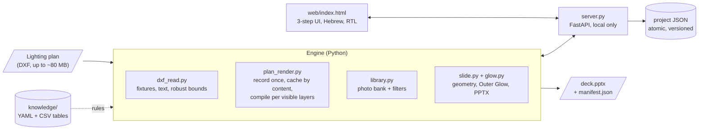

<h1 align="center">Lighting Deck Generator</h1>

<p align="center">
  <b>Turns a lighting plan drawn in CAD (DXF) into an editable PowerPoint deck that looks like the one the studio builds by hand,</b><br/>
  for an architectural lighting design studio. A local web app in Hebrew: mark the rooms, choose what is lit, pick photos, export.<br/>
  No AI at runtime: the output follows rules measured on the studio's own decks, kept in tables the studio can edit.
</p>

<p align="center">
  
  
  
  
  
  <a href="https://github.com/guyavron/lighting-deck-generator/actions/workflows/tests.yml"></a>
</p>

<p align="center">
  
  <br/><sub>Step 1: mark an area. Step 2: light fixtures by layer and type; the photo filters follow what is lit. Step 3: build the deck.
  Sped up 1.65×. <b>All data in this repository is fictional</b>: an invented apartment drawn in code, invented brands, and free Unsplash photos.</sub>
</p>

<p align="center">
  
  <br/><sub>Four slides from <a href="docs/sample-deck.pptx">the sample deck</a> (made by <code>python demo.py</code>). Every plan, photo and title is a separate object you can move in PowerPoint.</sub>
</p>

---

## The problem

For every project, the studio presents its lighting design to the client as a deck: one slide per idea ("living room | recessed spots"), with the plan of that room, the fixtures it talks about glowing, and photos of the product and of a similar space on the right.

Until now each deck was made by hand in Photoshop and PowerPoint:

- **Big decks.** Measured on 5 of the studio's past decks: on average **49 content slides, 69 photos and 41 glow marks per deck**.
- **Slow.** About **7–8 hours per deck, and more** with rounds of corrections (an estimate; it was never timed).
- **Repetitive.** The plan is already in the CAD drawing, and the fixtures already have codes in it. Yet each room was cropped, recoloured and lit by hand, and each photo was searched for again.

The constraint that shaped everything: **the output has to pass as the studio's own work.** A deck that looks "auto-generated" would not go to a client, however fast it was made.

## What it does

- **Reads the CAD drawing as it really is.** Finds the fixtures on the lighting layers (points, linear strips and round fixtures), sets aside the legend and the notes, decodes three kinds of broken Hebrew text, and draws the architecture in the studio's grey style.
- **Step 1, areas:** the designer drags a rectangle around each room and names it. What is inside the rectangle is exactly what the slide shows. A room can also be split into an orthogonal sub-area, which gets an opening slide with the area highlighted in yellow.
- **Step 2, slides:** light fixtures at three levels (a whole layer → one fixture type → single fixtures by clicking, or inside a polygon). Pick photos from a shared, tagged bank; the filters follow what is lit. Drag, resize and rotate the plan, the photos and the title in the preview, and approve the slide (✓) to lock it.
- **Step 3, deck:** a check that says which slides won't export and why, then an editable `.pptx` with a `manifest.json` (drawing hash, glow settings, layers) next to it.
- **Built for a team of non-developers.** Work is saved continuously and safely, deletions can be undone, and the tool never overwrites or deletes a file.

## Architecture



The rule behind the folder layout: **the knowledge lives in `knowledge/`, not in the code.** Which layers hold fixtures, what a block code means, the glow parameters, the slide geometry and the photo tags are all YAML or CSV tables. They can be read, diffed and corrected without touching Python.

| Folder | What's inside |
|---|---|
| [`src/`](src) | The server, the UI (one HTML file) and the engine: reading, rendering, glow, slide geometry, photo bank |
| [`knowledge/`](knowledge) | Every decision table. Here they hold the fictional demo bank |
| [`examples/`](examples) | Generators for **all** the demo data: the apartment DXF, product images drawn in code, 10 Unsplash photos ([credits](examples/photos/CREDITS.md)) |
| [`tests/`](tests) | 262 tests, run on Linux and Windows in CI |
| [`docs/`](docs) | The GIF, the sample deck, and [`decisions.md`](docs/decisions.md): 12 decisions, each marked measured / chosen / rejected |

## Key engineering decisions

| Decision | Why |
|---|---|
| **Every element is its own PowerPoint object**, not one flattened image | The designer asked to resize things at the end. The reference decks were flattened only because Photoshop forces it (just 45–76% of their slides are a single image). Slide and plan backgrounds are pure black, so the composed slide is pixel-identical to a flattened one. |
| **The designer marks the areas; the algorithm only suggests** | How a floor is divided changes from project to project. Marking a rectangle takes seconds, and a wrong automatic split costs more to fix than to draw. |
| **The glow was measured, not designed** | Not an invented "nice glow": 229 glow effects were extracted from the studio's Photoshop files: all of them Outer Glow, Screen blend, spread 0, noise 0. The renderer reproduces that effect from a calibrated formula. |
| **Knowledge in YAML/CSV, not in code** | The code was written with AI and will be rewritten. The decision tables are what survives a rewrite, and the studio can correct them. |
| **What you cut is what you see** | At first a slide was framed by the fixtures inside the area, which sit 50–100 cm from the walls, so every slide lost its outer walls. Now the window is exactly the rectangle the designer cut, and anything outside it is black. Step 3 warns when a fixture crosses the edge. |
| **Never overwrite, never delete** | Exports are new, timestamped files. Project saves are atomic, versioned and rejected if made from an older version. Nothing destructive happens without a person. |
| **Runs locally** | Drawings are large client files and should not leave the office. A local server also needs no accounts or hosting for a small team. |

## Challenges & how I solved them

**1. Two exports at the same time mixed up the plans**

- *Symptom:* a deck for one project came out with the plan of another project. No error, no warning. Reproduced twice.
- *Diagnosis:* the intermediate images were written to fixed file names that every export shared, and two exports in the same second got the same deck name.
- *Fix:* intermediate images stay in memory, and every file name is handed out once, under a lock. A test runs two exports in parallel and failed before the fix. *Rejected:* allowing one export at a time, because a second designer would just wait.

**2. "Changing the line weight does nothing"**

- *Symptom:* moving a slider seemed to have no effect, and opening a sub-area "took forever or failed".
- *Diagnosis:* the server did redraw, but every redraw replayed the whole drawing (hundreds of thousands of primitives): **7–9 seconds** even for one room. Each click queued another redraw, and the requests piled up.
- *Fix:* the drawing is compiled **once per set of visible layers** into arrays. A redraw is then a vector filter (visible layers ∩ window). **7.4 s → 0.3 s**, pixel-identical to before, and locked by a test that compares both renderers. *Rejected:* compiling every layer up front, measured at 3 minutes and 9.2 million vertices, mostly in layers nobody shows.

**3. A CAD file that lies about itself**

- *Symptom:* slides that were mostly empty paper, and fixture counts that were far too high.
- *Diagnosis:* in the real drawings the declared extents (`$EXTMIN/$EXTMAX`) were wrong by **up to 128×**. The fixture legend was drawn **228,000 units** to the side of a building only 6,500 units wide, and it was 7% of the fixtures, so percentiles didn't remove it. The notes and dimensions layers are also called `light …` and hold the most entities, so a naive `light*` rule would have counted 751 labels as fixtures. And the Hebrew text came in three broken forms: Hebrew typed on a Latin font, `\U+05D0` escapes, and reversed Latin (`THGIL` = `LIGHT`).
- *Fix:* declared extents are ignored and bounds come from robust statistics, the legend is split off by the gap on the X axis, the lighting layers are an explicit allow-list, and there is one decoder per text problem. The demo drawing reproduces every one of these traps on purpose, and the tests run on it.

**4. The human challenge: the tool has to work the way the studio works**

Two lessons, both from sitting with a designer at the studio several times:

- **Measure before asking.** Questions like "how strong is the glow?" or "where does the plan go?" have answers in the studio's past work. So layout and glow were measured on the reference decks and Photoshop files (the plan always starts at 4% of the width, the photos always end at 96%). The designer then judged the result by eye: the acceptance test is the studio, not a number.
- **A filter that would have hidden half the bank.** The designer asked for the photo search to follow the fixtures that are lit ("the process is long and hard"). Measured first: **216 of 417 photos had no install type yet**, so a hard filter on "recessed ceiling" would have left **34**. The chosen design is a *soft* filter: a photo tagged with a different type is hidden, but an untagged photo is shown below a line ("not tagged yet, may fit"). The chip visibly switches on, can be switched off, and once the designer touches a chip the drawing stops changing it. Result in that test: **232 photos instead of 417**, and no untagged photo disappeared. *Rejected:* a hard filter (hides half the bank) and a "boost only" ranking (doesn't shorten anything).

## Results

- **Tested on a real project of 111 slides:** every action under a second with no slowdown as the deck grows, all 111 previews load in 27 s, the export takes 10 s.
- **A full QA pass found 22 bugs**, from mixed-up plans to a crash that left a broken deck. All are fixed, each with a test that failed before the fix.
- **Status, honestly:** the tool is **being rolled out** at the studio. No deck made with it has gone to a client yet, so **there is no measured time saving**. The 7–8 hours above is the manual baseline it is meant to cut, and the next real project is where it gets timed.
- This repository: `python demo.py` builds the fictional inputs and a 4-slide deck in about 20–30 seconds; `python -m pytest` runs 262 tests.

## How I built it

I built this with an **AI-assisted workflow**. Claude wrote the code, and it also ran the large tests: driving the interface through a 111-slide project, and a failure-focused QA pass. My part:

- **Defined the workflow** the tool implements: mark all the areas once, then go area by area and slide by slide (light → photo → approve), and export at the end.
- **Worked with a designer at the studio**, several sessions, to fix what was awkward, improve the experience, and make the output meet the studio's standard. Many of the decisions above came from those sessions: rearranging in the preview instead of in PowerPoint, locking approved slides, the soft photo filter, "what you cut is what you see".
- **Made the calls** when there were options, after seeing them measured or drawn: which behaviour to change, what to reject, what to keep for later.
- **Tested it myself** on real drawings, and decided what goes public: the code and fictional data only, nothing from the studio.

## Limitations & next steps

- **The first load of a large drawing is slow:** about 90–100 seconds, then about 35 from the local cache.
- **Some fixture codes have no category yet** and are shown as raw codes (one of them, `zb`, is the third most common code in one real drawing, and nobody knows what it is). The mapping is a table, so it is a data fix, not a code fix.
- **The real photo bank (over 400 photos) hasn't been reviewed by eye yet.** Tags filled automatically only where there was evidence; style, finish and light quality are left empty on purpose, because a wrong value waiting for approval gets approved.
- **The automatic area suggestions in step 1 are weak** (they mix floors, or stretch past the building). Whether to drop them is an open decision; the GIF starts with them removed.
- **Deployment is not decided yet:** one shared server for the office, or an install on each designer's computer.
- **Next:** time the next real project with the tool, and decide the two open questions above.

## Tech stack

| Layer | Technology |
|---|---|
| Server | Python 3.10+, FastAPI, uvicorn (local only) |
| CAD | ezdxf (reading and recording), NumPy (compiled geometry), SciPy (furniture fill) |
| Images | Pillow (plan rendering, glow, sub-area masks) |
| Deck | python-pptx (separate objects, Hebrew titles as in the studio's decks) |
| UI | One HTML file, plain JavaScript, Hebrew right-to-left |
| Knowledge | YAML + CSV tables in `knowledge/` |
| Tests | pytest + httpx; node checks the UI's JavaScript; GitHub Actions on Linux and Windows (Python 3.10, 3.12, 3.14) |
| Demo data | ezdxf + shapely (the apartment), Pillow (product images), Unsplash photos |

## Run locally

```bash
git clone https://github.com/guyavron/lighting-deck-generator.git
cd lighting-deck-generator
pip install -r requirements.txt
python demo.py              # fictional inputs + out/demo_apartment_<time>.pptx (~30 s)
python demo.py --serve      # same, then opens the web interface on http://127.0.0.1:8000
python -m pytest            # 262 tests (the photo bank is generated on the first run)
```

The interface is in Hebrew. In it: **טען שרטוט** (load drawing) → drag a rectangle on the plan → **2 · עבודה** (work) → **3 · מצגת והפקה** (deck and export).

---

<p align="center"><i>Built by <a href="https://github.com/guyavron">Guy Avron</a> · Industrial Engineering & Management, Ben-Gurion University</i></p>
