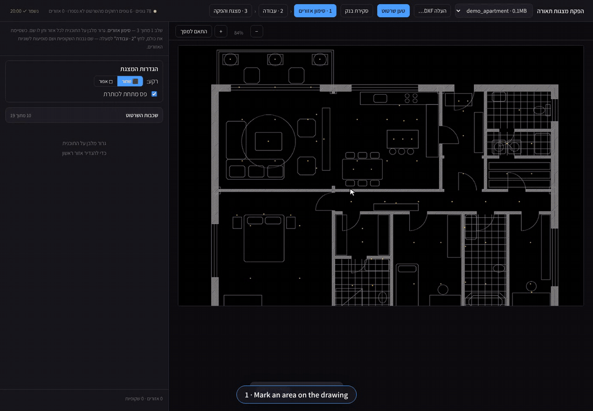
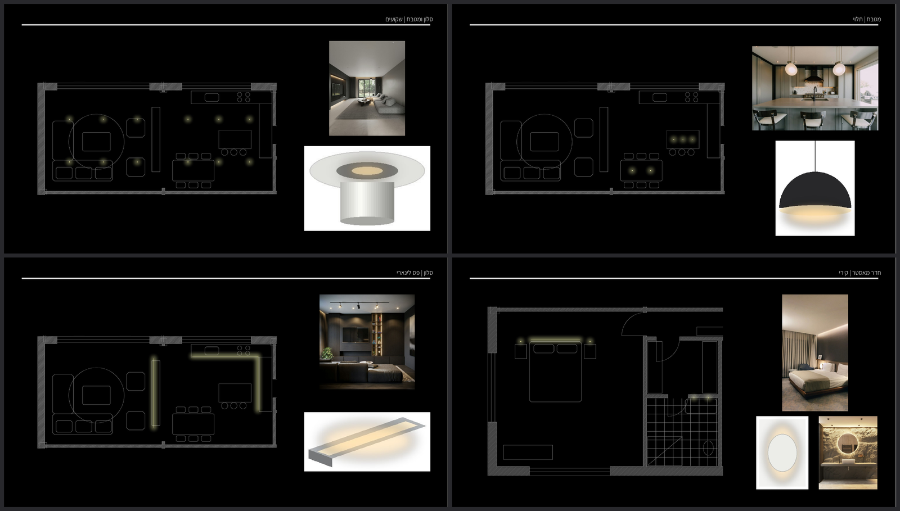
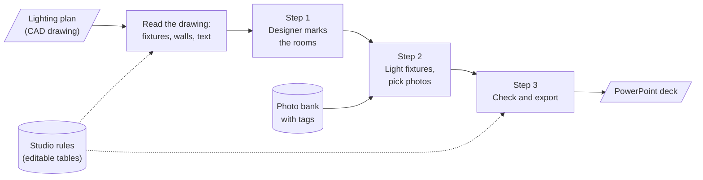

<h1 align="center">Lighting Deck Generator</h1>

<p align="center">
  <b>Turns a lighting plan drawn in CAD (DXF) into an editable PowerPoint deck that looks like the one the studio builds by hand,</b><br/>
  for an architectural lighting design studio. A web app in Hebrew that runs on the office computer: mark the rooms, choose what is lit, pick photos, export.<br/>
  No AI while it runs: the output follows rules measured on the studio's own decks, kept in tables the studio can edit.
</p>

<p align="center">
  
  
  
  
  <a href="https://github.com/guyavron/lighting-deck-generator/actions/workflows/tests.yml"></a>
</p>

<p align="center">
  
  <br/><sub>Step 1: mark an area. Step 2: light fixtures by layer and type; the photo filters follow what is lit. Step 3: build the deck.
  Sped up 1.65×. <b>All data in this repository is fictional</b>: an invented apartment drawn in code, invented brands, and free Unsplash photos.</sub>
</p>

<p align="center">
  
  <br/><sub>Four slides from <a href="docs/sample-deck.pptx">the sample deck</a> (made by <code>python demo.py</code>). Every plan, photo and title is a separate object you can move in PowerPoint.</sub>
</p>

---

## The problem

For every project, the studio presents its lighting design to the client as a deck: one slide per idea ("living room | recessed spots"), with the plan of that room, the fixtures it talks about glowing, and photos of the product and of a similar space on the right.

Until now each deck was made by hand in Photoshop and PowerPoint:

- **Big decks.** Counted on 5 of the studio's past decks: on average **49 content slides, 69 photos and 41 glowing fixtures per deck**.
- **Slow.** About **7–8 hours per deck, and more** with rounds of corrections (an estimate; it was never timed).
- **Repetitive.** The plan is already in the CAD drawing, and the fixtures are already marked in it. Yet each room was cropped, recoloured and lit by hand, and each photo was searched for again.

The rule that shaped everything: **the output has to pass as the studio's own work.** A deck that looks "auto-generated" would not go to a client, however fast it was made.

## What it does

- **Reads the CAD drawing as it really is.** Finds the light fixtures, sets aside the legend and the notes, fixes Hebrew text that comes out scrambled, and draws the walls in the studio's grey style.
- **Step 1, areas:** the designer drags a rectangle around each room and names it. What is inside the rectangle is exactly what the slide shows.
- **Step 2, slides:** light fixtures a whole group at a time, by type, or one by one. Pick photos from a shared, tagged bank; the photo filters follow what is lit. Move and resize the plan, photos and title in the preview, and approve the slide to lock it.
- **Step 3, deck:** a check that says which slides aren't ready and why, then an editable PowerPoint file.
- **Built for a team that doesn't code.** Work is saved all the time, deletions can be undone, and the tool never overwrites or deletes a file.

## How it works



The rule behind the folder layout: **the studio's knowledge lives in tables, not in the code.** Which drawing layers hold fixtures, what each fixture code means, how strong the glow is, where things sit on a slide and the photo tags are all in simple table files in `knowledge/`. They can be read and corrected without touching the code.

| Folder | What's inside |
|---|---|
| [`src/`](src) | The app: the screen (one HTML file) and the code that reads the drawing, draws the plan and builds the slides |
| [`knowledge/`](knowledge) | The studio's rules as tables. Here they hold the fictional demo data |
| [`examples/`](examples) | Scripts that create **all** the demo data: the apartment drawing, product images drawn in code, 10 Unsplash photos ([credits](examples/photos/CREDITS.md)) |
| [`tests/`](tests) | 262 tests, run automatically on Linux and Windows |
| [`docs/`](docs) | The GIF, the sample deck, and [`decisions.md`](docs/decisions.md): 12 decisions, each marked measured / chosen / rejected |

## Key decisions

| Decision | Why |
|---|---|
| **Every element is its own PowerPoint object**, not one flat image | The designer asked to be able to resize things at the end. The studio's old decks were flat images only because Photoshop works that way. The result looks exactly the same. |
| **The designer marks the rooms; the computer only suggests** | How a floor is divided changes from project to project. Drawing a rectangle takes seconds, and a wrong automatic split costs more to fix than to draw. |
| **The glow was measured, not designed** | Instead of inventing a "nice glow", the settings of 229 glow effects in the studio's Photoshop files were read. They were all the same kind, so the tool copies exactly that. |
| **Knowledge in tables, not in code** | The code was written with AI and may be rewritten. The tables are what survives a rewrite, and the studio can correct them. |
| **What you cut is what you see** | At first a slide was framed around the fixtures, which sit 50–100 cm from the walls, so every slide lost its outer walls. Now the slide shows exactly the rectangle the designer drew, and the tool warns when a fixture is cut by the edge. |
| **Never overwrite, never delete** | Every export is a new file with the time in its name. Saving can't overwrite newer work. Nothing is lost without a person deciding. |
| **Runs on the office computer** | Drawings are large client files and should not leave the office. It also needs no accounts or hosting for a small team. |

## Challenges & how they were solved

**1. Two exports at the same time mixed up the plans**

- *What happened:* a deck for one project came out with the plan of another project. No error, no warning.
- *Why:* both exports saved their temporary images under the same file names, so one overwrote the other.
- *Fix:* every export gets its own file names. A test runs two exports at once; it failed before the fix. *Rejected:* allowing only one export at a time, because a second designer would just wait.

**2. "Changing the line weight does nothing"**

- *What happened:* moving a slider seemed to do nothing, and opening a room "took forever or failed".
- *Why:* every change redrew the entire drawing from scratch, **7–9 seconds** even for one room. Each click added another redraw to the queue, and they piled up.
- *Fix:* the drawing is prepared once, and each redraw only picks out the part that's needed. **7.4 s → 0.3 s**, with exactly the same picture, checked by a test. *Rejected:* preparing everything up front, which took 3 minutes, mostly for parts nobody shows.

**3. A CAD file that lies about itself**

- *What happened:* slides that were mostly empty paper, and far too many fixtures counted.
- *Why:* in the real drawings, the size the file reports for itself was wrong by **up to 128 times**. The fixture legend was drawn far off to the side of the building, so it was counted as fixtures and stretched the drawing. The notes layer had a name like the lighting layers, so its 751 labels looked like fixtures. And Hebrew text came out scrambled in three different ways.
- *Fix:* the tool ignores the size the file reports and measures the drawing itself, separates the legend by the gap next to the building, uses a fixed list of lighting layers, and fixes each kind of scrambled text. The demo drawing has every one of these traps on purpose, and the tests run on it.

**4. The human challenge: the tool has to work the way the studio works**

Two lessons, both from sitting with a designer at the studio several times:

- **Measure before asking.** Questions like "how strong is the glow?" or "where does the plan go?" already have answers in the studio's past work. So the layout and glow were measured on old decks (the plan always starts at 4% of the width, the photos always end at 96%). The designer then judged the result by eye: the test is whether the studio accepts it, not a number.
- **A filter that would have hidden half the photos.** The designer asked for the photo search to follow the fixtures that are lit. Before building it, the bank was checked: **216 of 417 photos had no fixture type yet**, so a strict filter on "recessed ceiling" would have left only **34**. The chosen design is a *soft* filter: a photo of a different type is hidden, but a photo with no type yet is shown below a line ("not tagged yet, may fit"). The filter can be switched off. Result: **232 photos instead of 417**, and no untagged photo disappeared.

## Results

- **Tested on a real project of 111 slides:** every action under a second, all 111 previews load in 27 s, and the export takes 10 s.
- **A round of failure-focused testing found 22 bugs**, from mixed-up plans to a crash that left a broken deck. All are fixed, each with a test that failed before the fix.
- **Honest status:** the tool is **not in use yet**. It will be rolled out at the studio together with the [lighting schedule tool](https://github.com/guyavron/lighting-schedule-automation). No deck made with it has gone to a client, so **there is no measured time saving**. The 7–8 hours above is the manual baseline it's meant to cut.
- `python demo.py` builds the fictional inputs and a 4-slide deck in under a minute.

## How I built it

I built this with an **AI-assisted workflow: Claude wrote the code and the tests**, and also ran the large tests (driving the app through a 111-slide project, and the failure-focused testing). My part:

- **Defined the workflow** the tool follows: mark all the rooms once, then go room by room and slide by slide (light → photos → approve), and export at the end.
- **Worked with a designer at the studio** over several sessions, for first feedback and then to fix what was awkward and sharpen the tool to the studio's standard. Many decisions above came from those sessions: arranging things in the preview instead of in PowerPoint, locking approved slides, the soft photo filter, "what you cut is what you see".
- **Made the calls** when there were options, after seeing them measured or drawn: what to change, what to reject, what to leave for later.
- **Tested it myself** on real drawings, and decided what goes public: the code and fictional data only, nothing from the studio.

## Limitations & next steps

- **The first load of a large drawing is slow:** about 90–100 seconds, then about 35 the next time.
- **Some fixture codes have no category yet** and show up as raw codes. The mapping is a table, so it's a data fix, not a code fix.
- **The real photo bank (over 400 photos) hasn't been reviewed by eye yet.** Tags were filled in automatically only where there was clear evidence. Style and finish were left empty on purpose, because a wrong value waiting for approval tends to get approved.
- **The automatic room suggestions in step 1 are weak** (they mix floors, or stretch past the building). Whether to drop them is still open; the GIF starts with them removed.
- **Not decided yet:** one shared computer for the office, or an install on each designer's computer.
- **Next:** roll it out with the schedule tool, time the next real project, and decide the two open questions above.

## Tech stack

| Part | Technology |
|---|---|
| App | Python 3.10+, FastAPI (runs on the office computer only) |
| CAD drawings | ezdxf, NumPy, SciPy |
| Images | Pillow |
| PowerPoint | python-pptx |
| Screen | One HTML file, plain JavaScript, Hebrew right-to-left |
| Studio rules | YAML and CSV tables in `knowledge/` |
| Tests | pytest, run automatically on GitHub (Linux and Windows) |
| Demo data | ezdxf + shapely (the apartment), Pillow (product images), Unsplash photos |

## Run locally

```bash
git clone https://github.com/guyavron/lighting-deck-generator.git
cd lighting-deck-generator
pip install -r requirements.txt
python demo.py              # fictional inputs + a sample deck in out/
python demo.py --serve      # same, then opens the app on http://127.0.0.1:8000
python -m pytest            # 262 tests (the photo bank is generated on the first run)
```

The app is in Hebrew. In it: **טען שרטוט** (load drawing) → drag a rectangle on the plan → **2 · עבודה** (work) → **3 · מצגת והפקה** (deck and export).

---

<p align="center"><i>Built by <a href="https://github.com/guyavron">Guy Avron</a> · Industrial Engineering & Management, Ben-Gurion University</i></p>
